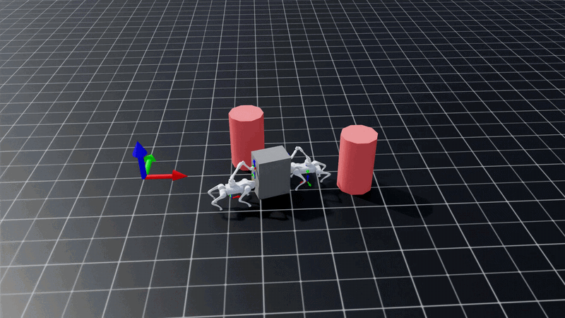
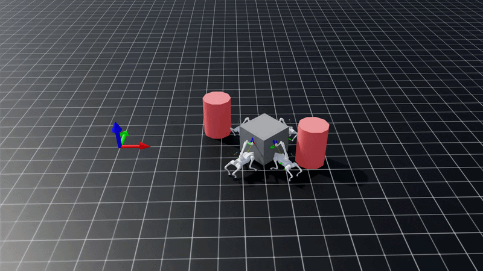
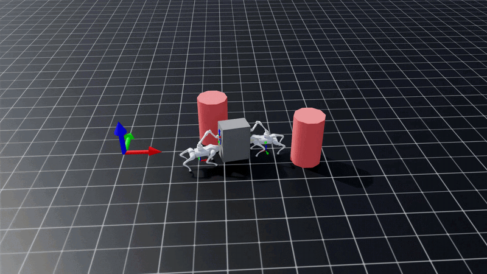
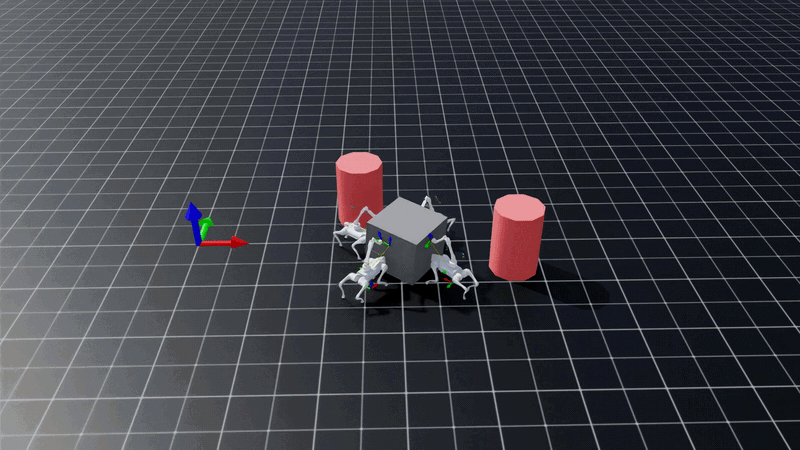

# Safety-Critical Control for Decentralized Cooperative Manipulation

**CBF safety filters and CLF stabilization for multi-robot object transport.** CDS 233 (Nonlinear Control) final project, Caltech, Spring 2026. Individual project by Taekyung (TK) Lee.

**Adaptive margin: the coupled CBF filter steers the team around obstacles without retraining the policy**

| 2 robots | 4 robots |
|---|---|
|  |  |

**Fixed margin: a margin tuned for one team size fails for the other**

| 2 robots | 4 robots |
|---|---|
|  |  |

Two or more quadrupedal robots (Unitree Go2 with a D1 arm) pinch, lift and carry a rigid payload through physical contact alone, with no communication between robots. The project analyzes this system with nonlinear control tools and then makes a pretrained decentralized RL policy (decPLM) safe around obstacles without retraining it.

## Results

| Part | Result |
|---|---|
| Relative degree and zero dynamics | From a 26-DOF Euler–Lagrange model, the payload-pose output has a constraint-consistent relative degree of 2, and the system is non-minimum phase: 5 zero-dynamics eigenvalues have positive real part (largest 3.54 rad/s) |
| CLF-QP vs. feedback linearization | Relaxing exact feedback linearization to one Lyapunov-decrease constraint frees 7 input DOF; arm-shape drift drops 10× and control effort halves, at the cost of looser output tracking |
| Coupled CBF safety filter | Wrapping decPLM's box-twist command in a CBF-QP keeps the box and every robot base outside obstacles, without retraining |
| Adaptive margin | A fixed margin does not carry over across team sizes; an online margin that measures the rigid-model error each step tunes itself from 0.141 m (2 robots) to 0.160 m (4 robots), with zero physical collisions |

All safety-filter results are from simulation in Isaac Lab.

## Repository structure

```
cooperative_transport_cds_233/
├── dynamics_analysis/
│   ├── system_model_notes.txt      system description and modeling assumptions
│   ├── feedback_linearization/     26-DOF constrained model, FL controller, zero-dynamics study (NumPy/SciPy)
│   └── clf_qp/                     CLF-QP controller and head-to-head comparison with FL
├── safety_filter/
│   ├── README.md                   how to install the filter into decPLM and run it
│   ├── CBF_safety_filter.md        design notes: coupled CBF, solver, tuning
│   ├── adaptive_margin.md          online self-tuning margin
│   ├── decplm_overlay/             new files to copy into the decPLM codebase
│   ├── decplm_changes.patch        edits to existing decPLM files (task registration, play script)
│   └── results/                    rollout GIFs and performance figures
├── grasp_morph/                    prototype of the hierarchical extension (grasp-shape changes near obstacles)
├── media/                          Isaac Sim rollouts (GIF) and feedback-linearization videos
├── report/CDS233_final_report.pdf
└── slides/CDS233_final_presentation.pdf
```

## Setup and usage

### Dynamics analysis (no simulator needed)

```bash
pip install numpy scipy matplotlib
cd dynamics_analysis/feedback_linearization
python smoke_test.py      # model checks: SPD inertia, constraint residual, decoupling rank
python study.py           # Experiments A and B: output convergence, zero dynamics
python spectrum.py        # Experiment C: zero-dynamics eigenvalue spectrum
cd ../clf_qp
python run_clf.py         # CLF-QP vs. FL comparison
```

### Safety filter (Isaac Lab)

The filter is an extension of [decPLM](https://github.com/osudrl/Decentralized-Pinch-Lift-Move) and needs its Isaac Lab environment and pretrained policy. See [`safety_filter/README.md`](safety_filter/README.md) for installation, then:

```bash
./run_play_cbf.sh --mode both --robots 2   # baseline vs. filtered, 2 robots
./run_play_cbf.sh --mode on --robots 4     # filtered, 4 robots
```

## Report, slides and video

- [Final report](report/CDS233_final_report.pdf)
- [Presentation slides](slides/CDS233_final_presentation.pdf)
- [Presentation video](https://drive.google.com/file/d/1N9OcBcvO92QUrtDNgPQHnXfKiVIHDs9h/view?usp=sharing)

## Acknowledgments

The decentralized pinch-lift-move policy and its training code are from decPLM (Oregon State University Dynamic Robotics and AI Lab). This project adds the analysis, the CLF-QP controller, the safety filter and the adaptive margin.
