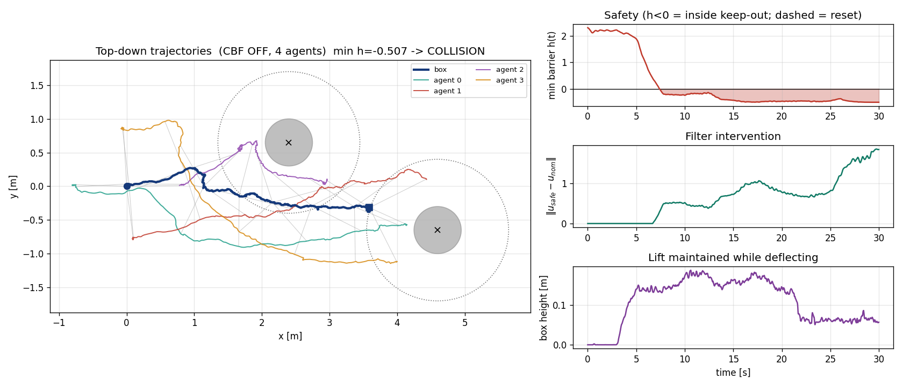
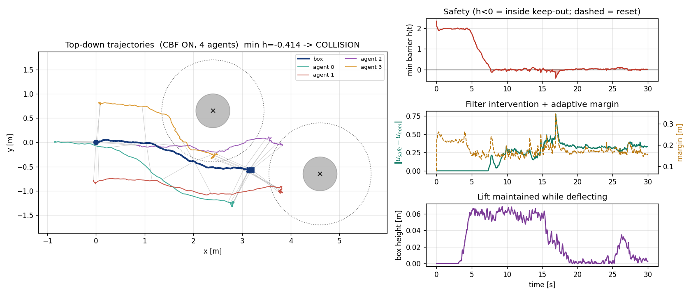
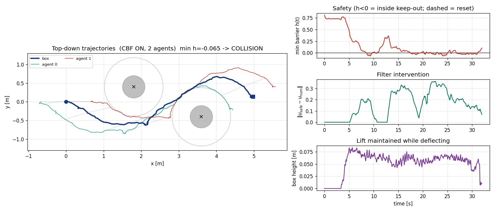
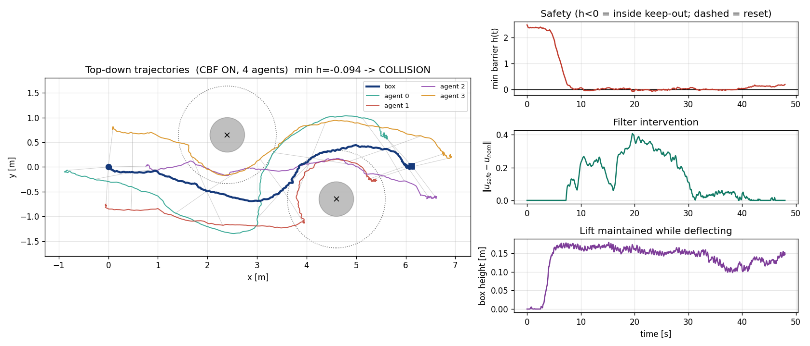

# Coupled CBF safety filter for decPLM

decPLM was trained in open space, so a commanded box trajectory through an obstacle drives the team into it. This module replaces decPLM's box-twist command with the solution of a minimally invasive CBF-QP that keeps the box and every robot base outside obstacles. The learned policy is unchanged. Design notes: [`CBF_safety_filter.md`](CBF_safety_filter.md) and [`adaptive_margin.md`](adaptive_margin.md).

## Install into decPLM

The filter was developed on decPLM's initial public commit (`b6be566`).

```bash
git clone https://github.com/osudrl/Decentralized-Pinch-Lift-Move.git
cd Decentralized-Pinch-Lift-Move
git checkout b6be566
# follow decPLM's README to set up Isaac Lab and download the pretrained policy

# add this project's files and edits
cp -r /path/to/cooperative_transport_cds_233/safety_filter/decplm_overlay/. .
git apply /path/to/cooperative_transport_cds_233/safety_filter/decplm_changes.patch
```

The overlay adds:

| File (under `drail_extensions/drail_extensions/research_bikram/`) | Purpose |
|---|---|
| `mdp/safety/cbf_qp.py` | Batched CBF-QP: constraint assembly and Hildreth solver (self-test: `python cbf_qp.py`) |
| `mdp/commands/cbf_safe_velocity_height_command.py` | Drop-in replacement for `box_command` that filters the command each step, with the adaptive margin |
| `mdp/commands/consensus_velocity_height_command.py` | Command term for the consensus variant of the task |
| `tasks/.../*_obstacles_env_cfg.py` | Obstacle scenes for 2 and N robots |
| `tasks/go2_d1_box_saw/go2_d1_marl_box_consensus_lift_and_move/` | Consensus task configuration |
| `scripts/play_cbf.py` | Evaluation driver: runs the policy with and without the filter and logs safety and grasp metrics |
| `scripts/cbf_viz.py` | Performance figure and top-down trajectory GIF from a rollout |
| `scripts/cbf_standalone_demo.py` | 2-D check of the coupled filter without Isaac Lab |
| `scripts/cbf_robust_margin.py` | Offline worst-case margin estimate from saved runs |
| `run_play_cbf.sh` (repo root) | Wrapper: baseline vs. filtered, `--robots {2,4}`, `--video` |

`decplm_changes.patch` registers the obstacle tasks, exports the new command terms, adds the observations they need, and lets the play script accept the filter options.

## Run

```bash
./run_play_cbf.sh --mode both --robots 2            # baseline and filtered, 2 robots
./run_play_cbf.sh --mode on --robots 4 --video      # filtered, 4 robots, with video
```

## Results

| | |
|---|---|
|  |  |
| Without the filter the team drives into the obstacles | Filter with the adaptive margin, 4 robots: no collisions |

Fixed margins tuned for one team size fail for the other:

| 2 robots, fixed margin 0.15 m | 4 robots, fixed margin 0.088 m |
|---|---|
|  |  |
